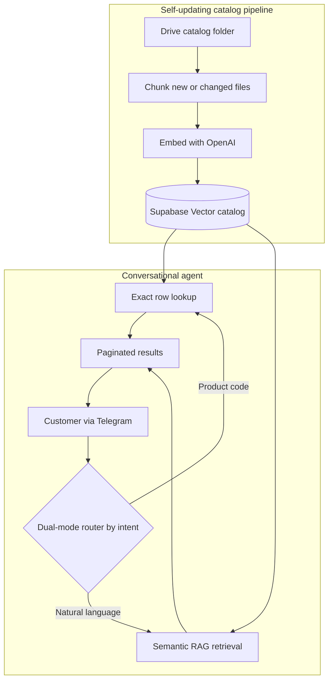

# AI Shopping Assistant

## Project status and evidence

**Portfolio build.** Personal technical reference; no measured retailer support outcome or current stock/price guarantee.

**My contribution:** Implemented exact catalog lookup, semantic retrieval, ingestion and conversational result pagination.

**Verification:** Recorded demonstration and public workflow exports.

Agentic product search that answers shopper questions over a self-updating catalog, with exact code lookups plus semantic RAG.

**[Watch the demo](https://youtu.be/POsvx4is3UU)**

## The problem

Shoppers ask about products in two very different ways: some type the exact product code they want, most describe what they are looking for in their own words. A single search method serves one group and fails the other. On top of that, keeping the product catalog in sync with a changing inventory is slow, manual work that quickly goes stale.

## What it does

- Answers customer product questions over a Supabase Vector catalog
- Routes queries by intent: regex-detected product codes get an exact row lookup, natural-language questions get semantic retrieval
- Keeps the catalog current: a pipeline watches a Drive folder, chunks and embeds each new or changed file automatically
- Returns paginated results for large matches

## Architecture

## Stack

n8n, Supabase Vector, OpenAI (chat + embeddings), RAG, Telegram.

## Workflows

| File | Role |
|---|---|
| `chat-agent.json` | The conversational agent with the dual-mode retrieval router |
| `kb-ingestion.json` | Self-updating catalog pipeline (watch folder, chunk, embed, upsert) |

## Import and setup

1. Import both JSONs into n8n.
2. Create credentials: OpenAI, Supabase, Telegram. Credential references are name-only placeholders.
3. Point the ingestion workflow at your own catalog folder and Supabase project.

## Note on redaction

All credentials, webhook IDs, and file IDs have been replaced with self-describing placeholders. The workflow logic is exactly what runs in the demo.

## License

Released under the MIT License. See [LICENSE](LICENSE).

---

Built by [Moamen Elsharkawy](https://www.linkedin.com/in/moamen--elsharkawy/), AI Automation Engineer. More builds: [portfolio](https://www.notion.so/Moamen-Elsharkawy-AI-Automation-Specialist-c201df9dd81482998591011f978b1bda) | [GitHub profile](https://github.com/Moamen-Elsharkawy)
